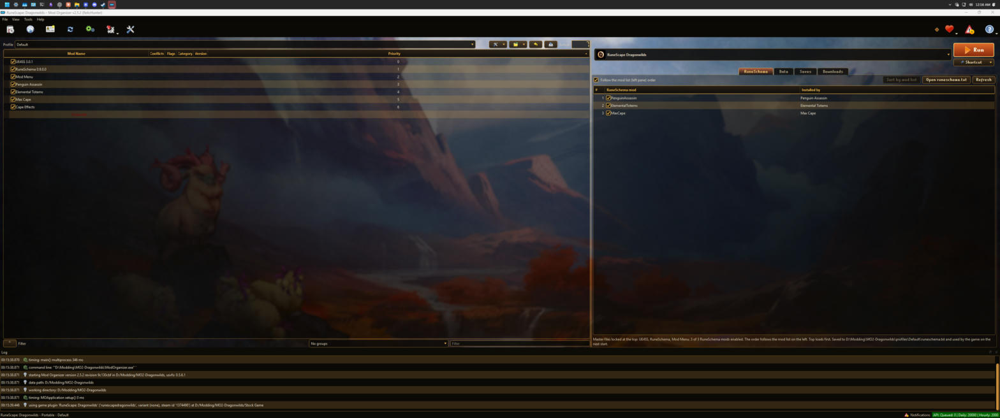

<!-- Made by Claude Ai & Relic Hunter -->

# Dragonwilds MO2

**Mod Organizer 2 support for RuneScape: Dragonwilds.** It manages UE4SS Lua mods, RuneSchema mods and pak mods, and keeps the RuneSchema load order in step with your mod list. It also comes with a Dragonwilds theme.

## Downloads

Get them from the [Releases](../../releases) page:

| File | What it is |
|---|---|
| `Dragonwilds-MO2-Standalone-1.0.0.zip` | A complete, ready-to-go MO2 2.5.2 for Dragonwilds. Unzip it and start it. |
| `Dragonwilds-MO2-Support-1.0.0.zip` | An add-on for an MO2 2.5.2 you already have. |

## Features

- **Installs in the right place:** UE4SS mods go to `ue4ss/Mods`, RuneSchema core and content to `ue4ss/Mods/RuneSchema/mods`, and pak mods to `Content/Paks/~mods`. A mod that ships both a mod folder and a RuneSchema folder stays one entry.
- **Master files:** UE4SS, RuneSchema and Mod Menu are locked at the top of the list, under a *Master Files* separator.
- **RuneSchema tab:** `runeschema.txt` follows the left list, and you can switch mods on and off. UE4SS `mods.txt` is written for you.
- **UE4SS start fix:** a 1.5 KB boot DLL makes UE4SS start before the game engine, so RuneSchema sees every pak and DataTable. The source is in [`tools/build_bootstrap_dll.py`](tools/build_bootstrap_dll.py).
- **Helpy works:** RuneSchema's Helpy window finds RuneSchema through a temporary folder link that MO2 removes when the game closes.
- **Downloads:**
  - Nexus "Mod Manager Download" sends mods to MO2.
  - Manual downloads from **Nexus** and **CurseForge** are moved into MO2's Downloads tab, but only files that really contain Dragonwilds content.
  - MO2 looks up the Nexus info for each file.
  - Auto-install is optional and off by default.
- **Categories and separators:** Nexus's Dragonwilds categories, with matching separators in the mod list. Short how-to notes are added to Relic Hunter's mods.
- **Tidy Overwrite:** logs and data the game writes go back into the mod that owns them.
- **Like other MO2 games:** profile-specific saves and INI files (Engine, GameUserSettings, Input), and save game listing.
- **Theme:** a Dragonwilds theme and splash, plus a Discord button.

## Install

**Stand-alone:** unzip the `Dragonwilds MO2` folder outside Program Files and start `ModOrganizer.exe`. A *Getting started* window walks you through the rest.

**Add-on:** install [MO2 2.5.2](https://github.com/ModOrganizer2/modorganizer/releases/tag/v2.5.2), unzip the add-on into the MO2 folder, then create a new instance for *RuneScape: Dragonwilds*.

Both READMEs (`pack/`) explain:
- what MO2 changes in the game folder
- how to turn each feature off
- where the logs are
- how to uninstall

## Repository layout

| Folder | Contents |
|---|---|
| `plugin/` | The game plugin (`game_rsdragonwilds.py`), the boot DLL, mod notes and the Discord icon |
| `theme/` | The QSS theme and art; `make_theme_art.py` rebuilds the art |
| `pack/` | The player READMEs and the third-party notice |
| `tools/` | `build_pack.py` and `build_standalone.py` make the zips; `build_bootstrap_dll.py` rebuilds the boot DLL |
| `tests/` | Offline tests: archive layouts and download detection (`python tests/test_checker.py`) |
| `wabbajack/` | The Wabbajack game-registry entry for RuneScape: Dragonwilds |

**Dev tools:**
- They expect an MO2 2.5.2 folder at `D:\Modding\MO2-Dragonwilds`. Pass another path as the first argument to `build_standalone.py`.
- The tests need MO2's Python 3.12 libraries.

## Links

- Discord: [discord.gg/BumVNYDUec](https://discord.gg/BumVNYDUec)
- Nexus: [RuneScape: Dragonwilds](https://www.nexusmods.com/runescapedragonwilds)

## License

[GPL v3](LICENSE), the same license as Mod Organizer 2. See [`pack/THIRD-PARTY.txt`](pack/THIRD-PARTY.txt) for MO2's sources and the font and art credits. This is a fan project; it is not made or endorsed by Jagex Ltd.
